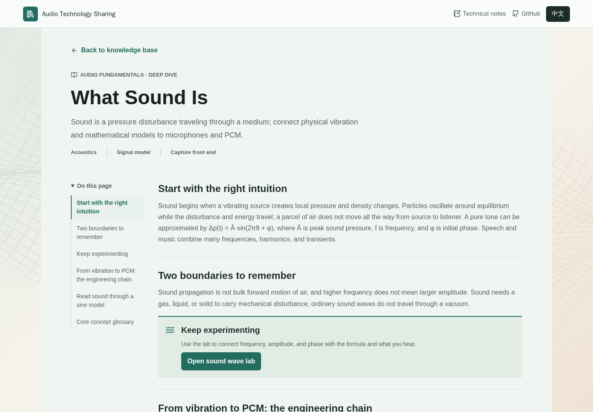

<p align="center">
  <h1 align="center">Audio Technology Sharing</h1>
  <p align="center">
    Audio Technology Sharing: a structured knowledge base and interactive website for learning audio fundamentals, hardware, software, DSP, AI audio, and applications.
  </p>
</p>

<p align="center">
  <a href="./README.md">English</a> ·
  <a href="./READMEs/README.zh-CN.md">简体中文</a>
</p>

<p align="center">
  
  
  
  
  
</p>

---

## Overview

Audio Technology Sharing is a content-first repository and web app for organizing audio technology concepts into searchable cards, diagrams, articles, and interactive learning labs.

The website provides a simple way to browse audio fundamentals, hardware, software, signal processing, AI audio algorithms, and real-world applications. Topic cards can open detailed explanations and focused labs for visual or interactive learning.

**[Explore the website](https://cpw640530.github.io/audio-technology-sharing/)** · English and Chinese supported.

## Interface and Reading Path

- **Find a topic:** use the knowledge outline on the left, or search and filter the topic cards in the main area. Small screens use a single-column layout.
- **Read the details:** open a topic page with a section outline, diagrams, engineering context, and links to adjacent topics.
- **Try the lab:** follow the lab entry to explore the topic through interactive controls or guided visual explanations. Return to the detailed article or the knowledge base afterward.
- **Explore further:** technical notes form a separate section for work-related learning; reference websites at the bottom of the homepage provide further reading.
- **Choose your language:** the site starts in English and remembers your language choice. A slowly moving 3D waveform surface forms a non-interactive background, with a static reduced-motion mode and a plain-background fallback when WebGL is unavailable.

The screenshots below were captured from the production build on October 28, 2026, with background motion paused for readability. Local changes appear on the published site only after deployment.

<p align="center">
  
</p>

## Detailed Articles

Topic pages connect concepts, engineering boundaries, and practical experiments. The section outline on the left helps navigate the article, while the lab entry continues the learning path.

<p align="center">
  
</p>

## Interactive Labs

The project includes visual learning labs for key audio concepts. For example, the sound wave lab helps readers connect waveform parameters with what they hear and see.

<p align="center">
  
</p>

## Why This Repository Exists

Audio technology spans physics, electronics, embedded systems, operating systems, digital signal processing, machine learning, and product applications. This repository keeps those topics in one structured place so future website content can be planned and expanded consistently.

It is designed for:

- Preparing audio technology sharing website content.
- Building article outlines and topic pages.
- Planning diagrams for audio signal chains and algorithms.
- Organizing traditional DSP and AI audio concepts together.
- Creating a reusable content foundation for future audio technology projects.

## Knowledge Areas

<p align="center">
  
</p>

| Area | Topics |
| --- | --- |
| Audio fundamentals | Sound, audio units, sampling, quantization, encoding, listening perception and metrics |
| Audio hardware | Microphones, ADC / DAC / Codec, digital audio interfaces, amplifiers and speakers |
| Audio software | System audio architecture, ALSA, real-time processing, audio codecs |
| Traditional algorithms | Core signal processing (FFT/STFT, filters, EQ, dynamics), speech enhancement, spatial audio |
| AI audio | Overall processing flow, ASR, TTS, generation, event detection, enhancement, neural audio coding |
| Applications | Bluetooth audio, conferencing, robots, in-car acoustics, IoT and content creation |

## Quick Start

Visit the published website:

- [https://cpw640530.github.io/audio-technology-sharing/](https://cpw640530.github.io/audio-technology-sharing/)

Start from the main knowledge outline:

- [Audio Technology Sharing Knowledge Outline](docs/audio_technology_knowledge_outline.md)

The outline provides a content overview. Current topic metadata lives in `src/content/knowledge.ts`; detailed pages and labs are implemented under `src/components/`.

To run the web app locally:

```bash
npm install
npm run dev
```

Useful commands:

```bash
npm test
npm run build
```

## Content Structure

```text
.
├── README.md
├── READMEs/
│   └── README.zh-CN.md
├── index.html
├── package.json
├── src/
│   ├── App.tsx
│   ├── components/
│   ├── content/
│   └── styles.css
└── docs/
    └── audio_technology_knowledge_outline.md
```

## Learning Examples

The articles and labs connect concepts to practical questions:

- **Beginner guides**: sample rate, bit depth, frequency response, audio formats, Bluetooth latency.
- **Hardware explainers**: microphones, ADC/DAC conversion, digital interfaces, amplifiers and speakers.
- **Algorithm visualizations**: FFT, filtering, noise suppression, echo cancellation, beamforming.
- **AI audio series**: speech recognition, speech synthesis, AI denoising, voice cloning, audio generation.
- **Application case studies**: conferencing systems, smart speakers, in-car voice interaction, live streaming audio.

## Language

This repository provides separate README files for each language:

- [English](./README.md)
- [简体中文](./READMEs/README.zh-CN.md)

GitHub README files do not run JavaScript, so language switching is implemented with normal Markdown links.

## License

No license has been selected yet.
