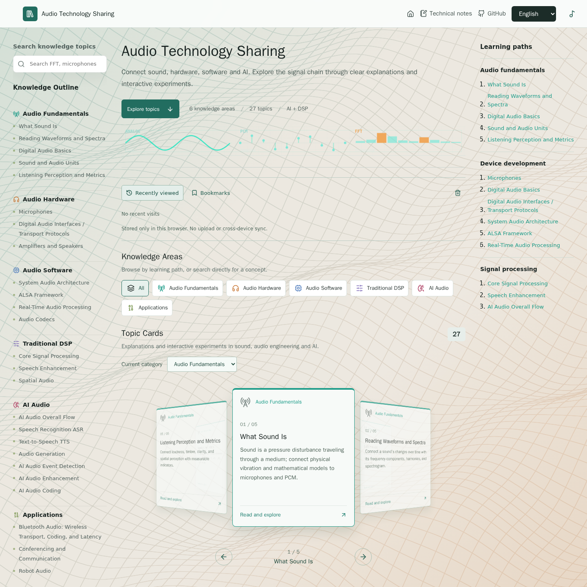
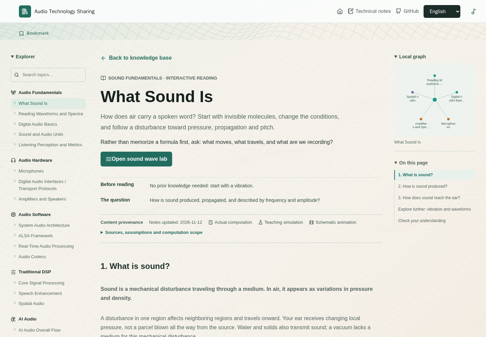
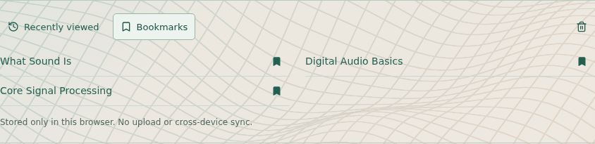

<h1 align="center">Audio Technology Sharing</h1>
<p align="center">Follow the signal. Change a parameter. See why the result changes.</p>

<p align="center">
  <a href="./README.md">English</a> ·
  <a href="./READMEs/README.zh-CN.md">简体中文</a> ·
  <a href="./READMEs/README.zh-TW.md">繁體中文</a> ·
  <a href="./READMEs/README.ja.md">日本語</a> ·
  <a href="./READMEs/README.ko.md">한국어</a>
</p>

<p align="center">
  
  
  
</p>

## Explore the Website

**[Open the website](https://cpw640530.github.io/audio-technology-sharing/)** · **[Browse topics](https://cpw640530.github.io/audio-technology-sharing/#top)** · **[Try the sound wave lab](https://cpw640530.github.io/audio-technology-sharing/#/labs/sound-wave)**

Audio Technology Sharing is a visual knowledge base for students, engineers and audio enthusiasts. It connects sound, hardware, software, DSP, AI and applications through illustrated articles and interactive experiments, rather than a glossary of isolated terms.

Currently: **6 knowledge areas, 27 topic articles and 22 standalone labs**, in English, Simplified Chinese, Traditional Chinese, Japanese and Korean. Some topics use inline diagrams and demonstrations instead of a separate lab.

<p align="center"></p>

All screenshots on this page were captured from the production build on **November 12, 2026**. They use the English interface and the reduced-motion setting; the website supports all five languages. Screenshots show the local build, not a verification of the latest online deployment.

## Interactive Labs: See What Changes

Why does a higher bit depth reduce quantization error? How does window length change a spectrogram? What does an echo canceller actually subtract? Change the conditions and compare the results.

| Lab | Try it | What to look for |
| --- | --- | --- |
| [Sound waves](https://cpw640530.github.io/audio-technology-sharing/#/labs/sound-wave) | Change frequency, amplitude and phase; play the signal | Period, amplitude and phase are different properties |
| [Waveforms and spectra](https://cpw640530.github.io/audio-technology-sharing/#/labs/wave-spectrum) | Adjust harmonic components and relative phase | Connect time-domain sums with ideal amplitude spectra |
| [Digital audio](https://cpw640530.github.io/audio-technology-sharing/#/labs/sampling-quantization) | Compare sampling and quantization; inspect PCM words and DAC reconstruction | Separate time sampling, amplitude precision and reconstruction |
| [FFT / STFT](https://cpw640530.github.io/audio-technology-sharing/#/labs/core-signal-processing) | Compare nearby tones, window lengths, hop sizes and impulses | Follow a PCM window into its spectrum; distinguish bin spacing from resolving nearby frequencies |
| [Speech enhancement](https://cpw640530.github.io/audio-technology-sharing/#/labs/speech-enhancement) | Switch AEC, noise suppression and AGC; vary processing strength | Compare each stage's input/output and follow the upstream effects |

<p align="center"></p>

**Learning models, not measurement instruments.** Articles and labs label actual computation, teaching simulation and schematic animation, with reference sources, maintenance dates and assumptions. AI demonstrations do **not** run the cited production models or reproduce their benchmarks. AEC uses known synthetic components, not a production adaptive canceller. Not every lab has playback; pause background music before listening comparisons.

## Read, Experiment, Continue

1. **Find a topic:** browse the left-hand knowledge outline, search, or filter categories and rotate the topic cards. Smaller screens adapt the layout.
2. **Read with a purpose:** each article states what to know first, the question it answers and a suggested next reading. Section navigation and a draggable local relationship graph help connect topics.
3. **Test the idea:** use the lab where one exists, then return to the article. Guides explain the principles; labs focus on controls, observations and result interpretation.
4. **Share a specific page:** articles and labs have their own hash-based URLs. For example, [What Sound Is](https://cpw640530.github.io/audio-technology-sharing/#/topics/sound-wave) opens directly and survives a refresh, without requiring a server route per article.

<p align="center"></p>

The slowly moving 3D waveform surface is a non-interactive background. Reduced-motion mode keeps it still; where WebGL is unavailable, a Canvas 2D fallback draws the projected surface when supported. Technical notes remain a separate section, and reference websites at the bottom of the knowledge base provide further reading.

## Pick Up Where You Left Off

- **Recently viewed:** reopen up to eight recent topics, including the lab you visited.
- **Bookmarks:** save or remove a topic from its article or lab; find it again from the homepage.
- **Lab parameters:** supported controls are validated and restored on return. Reset the current lab to its defaults at any time. Playback, uploaded audio and transient animation states are not restored.
- **Your browser only:** no account, upload or cross-device sync. Clearing local learning data removes reading history, bookmarks and saved lab parameters, but keeps the language setting. Clearing browser/site data also removes this history; unavailable storage is reported in the interface.

<p align="center"></p>

## Knowledge Areas

| Area | Topics |
| --- | --- |
| Audio fundamentals | Sound, waveforms and spectra, sampling, quantization, encoding, audio units, listening perception and metrics |
| Audio hardware | Microphones, digital audio interfaces, amplifiers and speakers |
| Audio software | System audio architecture, ALSA, real-time processing, audio codecs |
| Traditional DSP | FFT/STFT, filters, EQ, dynamics, speech enhancement, spatial audio |
| AI audio | Overall processing flow, ASR, TTS, generation, event detection, enhancement, neural audio coding |
| Applications | Bluetooth audio, conferencing, robots, in-car acoustics, IoT and content creation |

<p align="center"></p>

## Run Locally

With Node.js and npm installed, use the repository lockfile:

```bash
npm ci
npm run dev
```

Validation and production build:

```bash
npm test
npm run build
```

Article and lab code is loaded on demand. Welcome images use responsive WebP assets with a PNG fallback. See the [loading measurements and remaining limits](docs/loading-performance-2026-11-12.md); this is not a claim of uniformly smooth performance on every device.

## Content and Maintenance

| Location | Purpose |
| --- | --- |
| `README.md`, `READMEs/` | Project introductions in five languages, including `README.zh-TW.md` |
| `src/content/knowledge.ts` | Categories, topic metadata and lab entries |
| `src/content/topicRoutes.ts` | Article/lab URLs and route mapping |
| `src/content/topicLearning.ts` | Prerequisites, learning questions and next-reading links |
| `src/content/topicCredibility.ts` | Sources, update dates, demonstration methods and assumptions |
| `src/components/` | Articles, diagrams, interactive labs and shared reading UI |
| `src/hooks/useLabState.tsx` | Validated local persistence for lab parameters |
| `src/styles.css` | Shared styling and responsive layout |
| `public/images/` | Illustrations and the screenshots used here |

The [knowledge outline](docs/audio_technology_knowledge_outline.md) provides a content overview. [Local return-visit notes](docs/local-return-visits.md) describe storage, reset behavior and privacy limits. Topic source files are the reference for current implementation.

## Languages

The README, interface, guides and labs support **English, Simplified Chinese, Traditional Chinese, Japanese and Korean**. The website starts in English and remembers the language you select. Model names, code, equations and text embedded in source images remain unchanged. GitHub language links open separate README files; no JavaScript is required.

Traditional Chinese (`zh-Hant`) is derived from Simplified Chinese using locally bundled ICU character-conversion mappings, not an online translation service. Regional terminology is not separately localized. After changing Chinese content, maintainers with ICU `uconv` installed can refresh mappings with `node scripts/generate-traditional.cjs`.

## License

No license has been selected yet.
