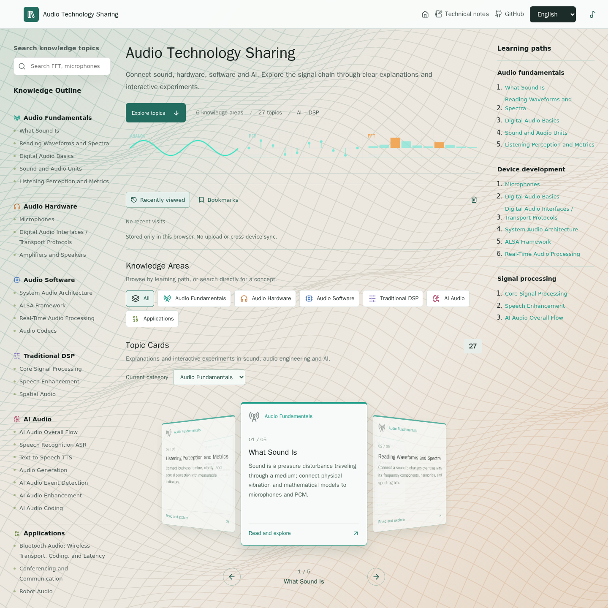
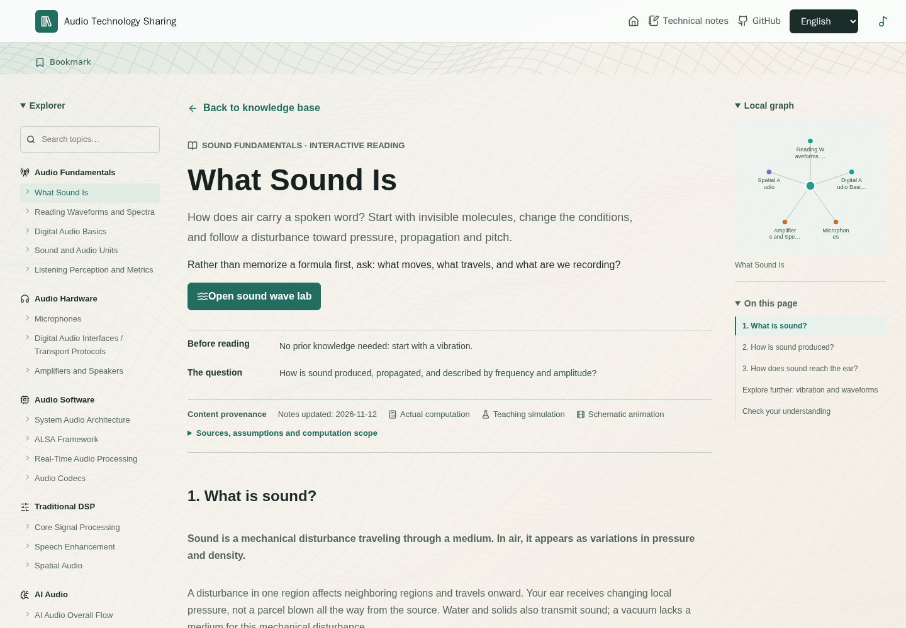
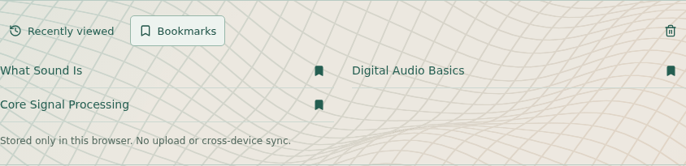

<h1 align="center">Audio Technology Sharing</h1>
<p align="center">信号を追い、パラメーターを変え、結果が変わる理由を確かめる。</p>

<p align="center">
  <a href="../README.md">English</a> ·
  <a href="./README.zh-CN.md">简体中文</a> ·
  <a href="./README.zh-TW.md">繁體中文</a> ·
  <a href="./README.ja.md">日本語</a> ·
  <a href="./README.ko.md">한국어</a>
</p>

<p align="center">
  
  
  
</p>

## Web サイトを見る

**[公開サイトを開く](https://cpw640530.github.io/audio-technology-sharing/)** · **[知識ベースを閲覧](https://cpw640530.github.io/audio-technology-sharing/#top)** · **[音波形ラボを試す](https://cpw640530.github.io/audio-technology-sharing/#/labs/sound-wave)**

Audio Technology Sharing は、学生、エンジニア、音声技術に関心のある人向けの視覚的な知識ベースです。用語を並べるだけでなく、図解記事とインタラクティブな実験を通して、音、ハードウェア、ソフトウェア、DSP、AI、応用分野を学習経路としてつなぎます。

現在は **6 分野、27 記事、22 個の独立したラボ**を、英語、簡体字中国語、繁体字中国語、日本語、韓国語で提供しています。一部のトピックは記事内の図解やデモで説明し、個別のラボを持ちません。

<p align="center"></p>

このページのスクリーンショットはすべて **2026 年 11 月 12 日の本番ビルド**から撮影し、英語表示と reduced-motion 設定を使用しています。Web サイトは 5 言語に対応します。スクリーンショットはローカルビルドを示すもので、オンラインの最新デプロイを検証したものではありません。

## インタラクティブなラボ：変化を確かめる

ビット深度を上げると量子化誤差が小さくなるのはなぜか。窓長を変えるとスペクトログラムが変わるのはなぜか。エコーキャンセラーは実際には何を差し引くのか。条件を変えて結果を比較します。

| ラボ | 試せること | 注目すること |
| --- | --- | --- |
| [音波](https://cpw640530.github.io/audio-technology-sharing/#/labs/sound-wave) | 周波数、振幅、位相を変え、信号を再生 | 周期、振幅、位相は異なる性質であること |
| [波形とスペクトル](https://cpw640530.github.io/audio-technology-sharing/#/labs/wave-spectrum) | 高調波成分と相対位相を調整 | 時間領域の加算と理想的な振幅スペクトルを結び付けること |
| [デジタル音声](https://cpw640530.github.io/audio-technology-sharing/#/labs/sampling-quantization) | サンプリングと量子化を比較し、PCM ワードと DAC 再構成を確認 | 時間サンプリング、振幅精度、再構成を区別すること |
| [FFT / STFT](https://cpw640530.github.io/audio-technology-sharing/#/labs/core-signal-processing) | 近接した音、窓長、ホップ長、インパルスを比較 | PCM 窓からスペクトルを追い、ビン間隔と近接周波数の分解能を区別すること |
| [音声強調](https://cpw640530.github.io/audio-technology-sharing/#/labs/speech-enhancement) | AEC、ノイズ抑制、AGC を切り替え、処理強度を変える | 各段階の入出力を比較し、上流の処理の影響を追うこと |

<p align="center"></p>

**学習用モデルであり、測定器ではありません。** 記事とラボは、実際の計算（`calculation`）、学習用シミュレーション（`simulation`）、概念図やアニメーション（`illustration`）を区別し、参照元、更新日、前提を示します。AI デモは引用した本番モデルを実行せず、そのベンチマークを再現しません。AEC は既知の合成成分を使うモデルであり、本番用の適応キャンセラーではありません。すべてのラボに再生機能があるわけではないため、聞き比べる前に背景音楽を一時停止してください。

## 読む、試す、次へ進む

1. **トピックを探す：**左側の知識アウトライン、検索、カテゴリーフィルター、回転するトピックカードを使います。小さい画面ではレイアウトが適応します。
2. **目的を持って読む：**各記事は前提知識、ここで答える問い、推奨する次の読書を示します。セクションナビゲーションとドラッグ可能なローカル関係グラフでトピックをつなげます。
3. **考えを試す：**ラボがあるトピックでは実験し、記事に戻ります。記事は原理を説明し、ラボは操作、観察、結果の解釈に集中します。
4. **特定のページを共有する：**記事とラボには固有のハッシュ URL があります。たとえば [「音とは何か」](https://cpw640530.github.io/audio-technology-sharing/#/topics/sound-wave) は直接開いて更新でき、記事ごとにサーバー側のルートを設定する必要はありません。

<p align="center"></p>

ゆっくり動く 3D 波形面は操作対象ではない背景です。reduced-motion では静止し、WebGL を利用できない場合は、対応していれば Canvas 2D のフォールバックで投影面を描画します。技術ノートは独立したセクションとして残り、知識ベース下部の参考サイトからさらに学べます。

## 続きから学ぶ

- **最近閲覧したトピック：**ラボを含め、最近の最大 8 件を開き直せます。
- **ブックマーク：**記事またはラボからトピックを保存・解除し、ホームから再び開けます。
- **ラボのパラメーター：**対応する操作項目は値を検証してから復元します。現在のラボはいつでも初期値に戻せます。再生状態、アップロードした音声、一時的なアニメーション状態は復元しません。
- **このブラウザだけ：**読書履歴、ブックマーク、対応するラボパラメーターは現在のブラウザの `localStorage` にのみ保存します。アカウント、音声ファイルのアップロード、端末間同期はありません。学習データを確認して消去すると、これらを削除し、言語設定は保持します。ブラウザやサイトのデータを消去すると履歴も消えます。保存領域を利用できない場合は画面に通知します。

<p align="center"></p>

## 知識分野

| 分野 | 内容 |
| --- | --- |
| 音声の基礎 | 音、波形とスペクトル、サンプリング、量子化、符号化、音声単位、聴感と指標 |
| 音声ハードウェア | マイク、デジタルオーディオインターフェース、アンプ、スピーカー |
| オーディオソフトウェア | システム音声アーキテクチャ、ALSA、リアルタイム処理、音声コーデック |
| 従来型 DSP | FFT/STFT、フィルター、EQ、ダイナミクス、音声強調、空間音声 |
| AI 音声 | 処理全体の流れ、ASR、TTS、音声生成、イベント認識、音声強調、ニューラル音声符号化 |
| 応用シーン | Bluetooth 音声、会議、ロボット、車載音響、IoT、コンテンツ制作 |

<p align="center"></p>

## ローカルで実行

Node.js と npm を用意し、リポジトリのロックファイルを使います：

```bash
npm ci
npm run dev
```

検証と本番ビルド：

```bash
npm test
npm run build
```

記事とラボのコードは必要なときに読み込まれます。ウェルカム画像はレスポンシブな WebP と PNG フォールバックを使います。[読み込み計測と残る制約](../docs/loading-performance-2026-11-12.md)を参照してください。すべての端末で同じ滑らかさになるという主張ではありません。ローカルでのテストやビルドは、オンラインへの最新デプロイを検証するものではありません。

## コンテンツと保守

| 場所 | 役割 |
| --- | --- |
| `README.md`、`READMEs/` | `README.zh-TW.md` を含む 5 言語のプロジェクト紹介 |
| `src/content/knowledge.ts` | 分類、トピックメタデータ、ラボの入口 |
| `src/content/topicRoutes.ts` | 記事・ラボの URL とルート対応 |
| `src/content/topicLearning.ts` | 前提知識、学習の問い、次の読書リンク |
| `src/content/topicCredibility.ts` | 参照元、更新日、デモの方法、前提と限界 |
| `src/components/` | 詳細記事、図解、インタラクティブなラボ、共有読書 UI |
| `src/hooks/useLabState.tsx` | 検証付きのラボパラメーターのローカル保存 |
| `src/styles.css` | 共有スタイルとレスポンシブレイアウト |
| `public/images/` | このページで使う図解とスクリーンショット |

[音声技術の知識概要](../docs/audio_technology_knowledge_outline.md)は内容の全体像を示します。[ローカル再訪の説明](../docs/local-return-visits.md)には保存、リセット、プライバシーの境界があります。現在の実装についてはトピックのソースファイルを参照してください。

## 言語

README、画面、記事、ラボは **英語、簡体字中国語、繁体字中国語、日本語、韓国語** に対応しています。Web サイトは英語で開始し、選択した言語を記憶します。モデル名、コード、数式、参考画像内の原文は変更しません。GitHub の言語リンクは通常の README リンクを開くため、JavaScript は必要ありません。

繁体字中国語（`zh-Hant`）は、オンライン翻訳サービスではなく、ローカルに同梱した ICU の文字変換マッピングを使って簡体字中国語から生成します。地域固有の用語は別途ローカライズしていません。中国語の内容を変更した場合、ICU `uconv` をインストールした環境で `node scripts/generate-traditional.cjs` を実行してマッピングを更新できます。

## ライセンス

ライセンスはまだ選択されていません。
