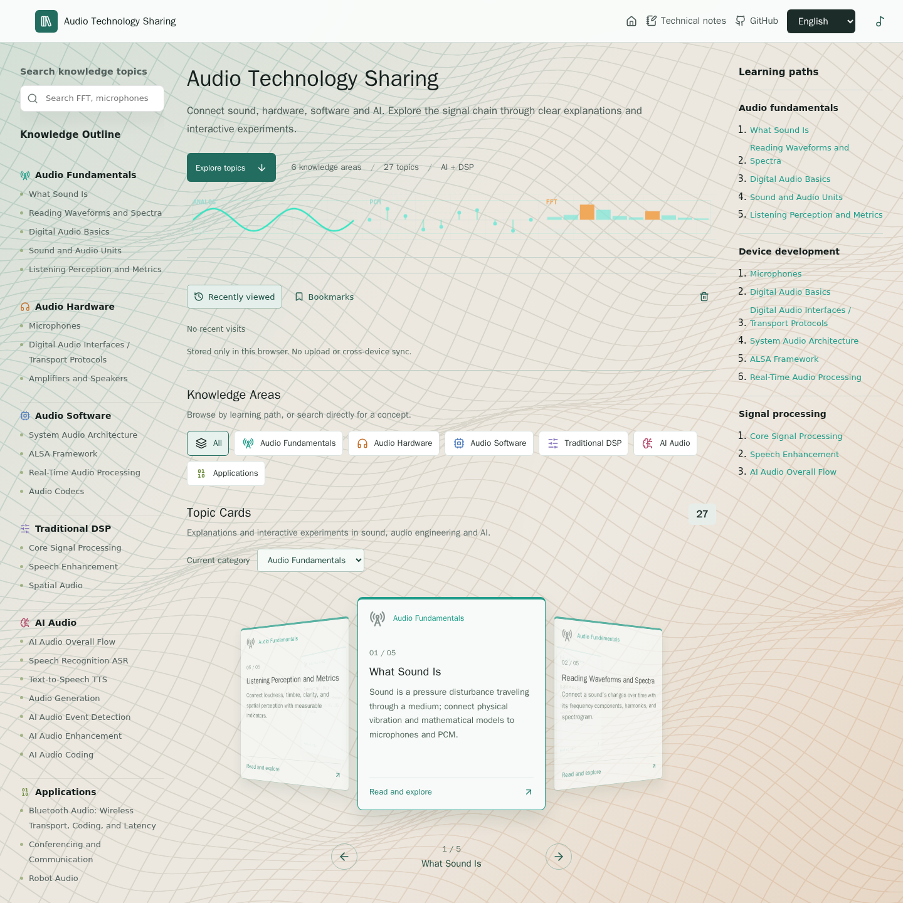
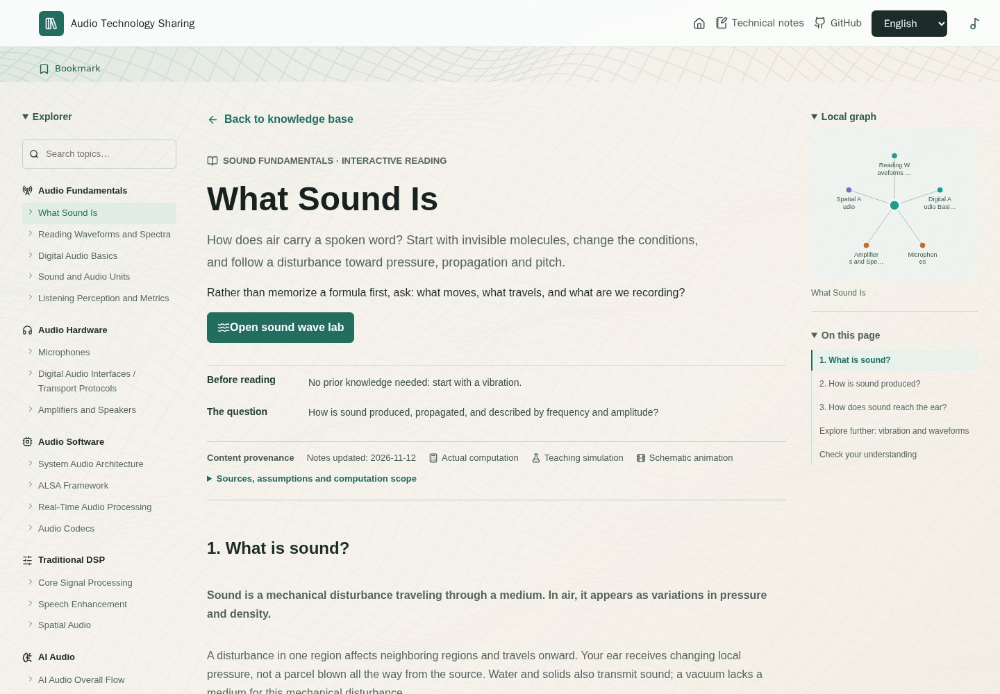
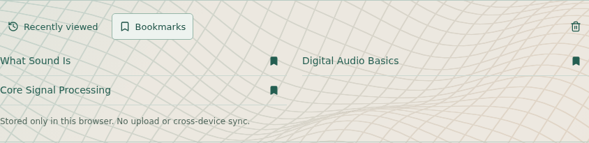

<h1 align="center">Audio Technology Sharing</h1>
<p align="center">신호를 따라가며 매개변수를 바꾸고, 결과가 달라지는 이유를 확인하세요.</p>

<p align="center">
  <a href="../README.md">English</a> ·
  <a href="./README.zh-CN.md">简体中文</a> ·
  <a href="./README.zh-TW.md">繁體中文</a> ·
  <a href="./README.ja.md">日本語</a> ·
  <a href="./README.ko.md">한국어</a>
</p>

<p align="center">
  
  
  
</p>

## 웹사이트 살펴보기

**[공개 웹사이트 열기](https://cpw640530.github.io/audio-technology-sharing/)** · **[지식 베이스 둘러보기](https://cpw640530.github.io/audio-technology-sharing/#top)** · **[소리 파형 랩 체험하기](https://cpw640530.github.io/audio-technology-sharing/#/labs/sound-wave)**

Audio Technology Sharing은 학생, 엔지니어, 오디오 기술에 관심 있는 사람을 위한 시각적 지식 베이스입니다. 용어를 나열하는 대신 도해 아티클과 인터랙티브 실험을 통해 소리, 하드웨어, 소프트웨어, DSP, AI, 응용 분야를 하나의 학습 경로로 연결합니다.

현재 **6개 지식 분야, 27개 주제 아티클, 22개의 독립 랩**을 영어, 중국어 간체, 중국어 번체, 일본어, 한국어로 제공합니다. 일부 주제는 별도 랩 대신 아티클 안의 도해와 데모로 설명합니다.

<p align="center"></p>

이 페이지의 스크린샷은 모두 **2026년 11월 12일 프로덕션 빌드**에서 촬영했으며, 영어 화면과 reduced-motion 설정을 사용했습니다. 웹사이트는 5개 언어를 지원합니다. 스크린샷은 로컬 빌드를 보여 주며, 온라인 최신 배포를 검증한 결과가 아닙니다.

## 인터랙티브 랩: 변화를 확인하기

비트 깊이가 커지면 양자화 오차가 줄어드는 이유는 무엇일까요? 윈도 길이가 바뀌면 스펙트로그램은 왜 달라질까요? 에코 캔슬러는 실제로 무엇을 빼는 걸까요? 조건을 바꾸고 결과를 비교해 보세요.

| 랩 | 해볼 수 있는 것 | 주목할 점 |
| --- | --- | --- |
| [소리 파형](https://cpw640530.github.io/audio-technology-sharing/#/labs/sound-wave) | 주파수, 진폭, 위상을 바꾸고 신호를 재생 | 주기, 진폭, 위상은 서로 다른 성질이라는 점 |
| [파형과 스펙트럼](https://cpw640530.github.io/audio-technology-sharing/#/labs/wave-spectrum) | 고조파 성분과 상대 위상을 조절 | 시간 영역의 합과 이상적인 진폭 스펙트럼을 연결하는 점 |
| [디지털 오디오](https://cpw640530.github.io/audio-technology-sharing/#/labs/sampling-quantization) | 샘플링과 양자화를 비교하고 PCM 워드와 DAC 재구성을 확인 | 시간 샘플링, 진폭 정밀도, 재구성을 구분하는 점 |
| [FFT / STFT](https://cpw640530.github.io/audio-technology-sharing/#/labs/core-signal-processing) | 인접한 톤, 윈도 길이, 홉 크기, 임펄스를 비교 | PCM 윈도를 스펙트럼까지 따라가 빈 간격과 인접 주파수 분해능을 구분하는 점 |
| [음성 향상](https://cpw640530.github.io/audio-technology-sharing/#/labs/speech-enhancement) | AEC, 노이즈 억제, AGC를 전환하고 처리 강도를 조절 | 각 단계의 입출력을 비교하고 앞단 처리의 영향을 따라가는 점 |

<p align="center"></p>

**학습용 모델이며 측정 장비가 아닙니다.** 아티클과 랩은 실제 계산(`calculation`), 학습용 시뮬레이션(`simulation`), 개념 도해나 애니메이션(`illustration`)을 구분하고 출처, 갱신일, 가정을 표시합니다. AI 데모는 인용한 프로덕션 모델을 실행하지 않으며 해당 벤치마크를 재현하지 않습니다. AEC는 알려진 합성 성분을 사용하는 모델이지 프로덕션용 적응형 캔슬러가 아닙니다. 모든 랩에 재생 기능이 있는 것은 아니므로 듣기 비교 전에는 배경 음악을 일시 정지하세요.

## 읽고, 실험하고, 다음으로

1. **주제 찾기:** 왼쪽 지식 아웃라인, 검색, 카테고리 필터, 순환하는 주제 카드를 사용합니다. 작은 화면에서는 레이아웃이 맞춰집니다.
2. **목적을 가지고 읽기:** 각 아티클은 선행 지식, 여기서 답하는 질문, 추천하는 다음 읽을거리를 제시합니다. 섹션 내비게이션과 드래그 가능한 로컬 관계 그래프로 주제를 연결합니다.
3. **아이디어 시험하기:** 랩이 있는 주제에서는 실험한 뒤 아티클로 돌아옵니다. 아티클은 원리를 설명하고 랩은 조작, 관찰, 결과 해석에 집중합니다.
4. **특정 페이지 공유하기:** 아티클과 랩에는 고유한 해시 URL이 있습니다. 예를 들어 [소리란 무엇인가](https://cpw640530.github.io/audio-technology-sharing/#/topics/sound-wave)는 직접 열고 새로 고칠 수 있으며, 아티클마다 서버 측 경로를 설정할 필요가 없습니다.

<p align="center"></p>

천천히 움직이는 3D 파형 표면은 조작할 수 없는 배경입니다. reduced-motion 모드에서는 정지하며, WebGL을 사용할 수 없으면 지원되는 경우 Canvas 2D 폴백이 투영된 표면을 그립니다. 기술 노트는 별도 섹션으로 유지하고, 지식 베이스 하단의 참고 웹사이트에서 추가 자료를 볼 수 있습니다.

## 다시 방문해 이어서 학습하기

- **최근 방문:** 랩 방문 기록을 포함해 최근 주제 최대 8개를 다시 엽니다.
- **북마크:** 아티클이나 랩에서 주제를 저장하거나 해제하고 홈에서 다시 찾습니다.
- **랩 매개변수:** 지원되는 조작값은 검증한 뒤 복원합니다. 현재 랩은 언제든 기본값으로 재설정할 수 있습니다. 재생 상태, 업로드한 오디오, 일시적인 애니메이션 상태는 복원하지 않습니다.
- **이 브라우저에만 저장:** 읽기 기록, 북마크, 지원되는 랩 매개변수는 현재 브라우저의 `localStorage`에만 저장합니다. 계정, 오디오 파일 업로드, 디바이스 간 동기화는 없습니다. 학습 데이터를 확인하고 지우면 이 항목들을 삭제하지만 언어 설정은 유지합니다. 브라우저나 사이트 데이터를 지워도 기록이 삭제됩니다. 저장 공간을 사용할 수 없으면 화면에 알립니다.

<p align="center"></p>

## 지식 분야

| 분야 | 주제 |
| --- | --- |
| 오디오 기초 | 소리, 파형과 스펙트럼, 샘플링, 양자화, 부호화, 오디오 단위, 청감과 지표 |
| 오디오 하드웨어 | 마이크, 디지털 오디오 인터페이스, 앰프, 스피커 |
| 오디오 소프트웨어 | 시스템 오디오 아키텍처, ALSA, 실시간 처리, 오디오 코덱 |
| 전통 DSP | FFT/STFT, 필터, EQ, 다이내믹스, 음성 향상, 공간 오디오 |
| AI 오디오 | 전체 처리 흐름, ASR, TTS, 오디오 생성, 이벤트 인식, 오디오 향상, 신경망 오디오 코딩 |
| 응용 시나리오 | Bluetooth 오디오, 회의, 로봇, 차량 음향, IoT, 콘텐츠 제작 |

<p align="center"></p>

## 로컬 실행

Node.js와 npm을 준비하고 저장소의 lockfile을 사용합니다.

```bash
npm ci
npm run dev
```

검증 및 프로덕션 빌드:

```bash
npm test
npm run build
```

아티클과 랩 코드는 필요할 때 로드됩니다. 시작 화면 이미지는 반응형 WebP와 PNG 폴백을 사용합니다. [로딩 측정과 남은 한계](../docs/loading-performance-2026-11-12.md)를 참고하세요. 모든 기기에서 같은 수준으로 부드럽다고 주장하는 내용은 아닙니다. 로컬 테스트와 빌드는 온라인 최신 배포를 검증하지 않습니다.

## 콘텐츠와 유지보수

| 위치 | 역할 |
| --- | --- |
| `README.md`, `READMEs/` | `README.zh-TW.md`를 포함한 5개 언어 프로젝트 소개 |
| `src/content/knowledge.ts` | 분류, 주제 메타데이터, 랩 진입점 |
| `src/content/topicRoutes.ts` | 아티클·랩 URL과 라우트 매핑 |
| `src/content/topicLearning.ts` | 선행 지식, 학습 질문, 다음 읽을거리 링크 |
| `src/content/topicCredibility.ts` | 출처, 갱신일, 데모 방법, 가정과 한계 |
| `src/components/` | 상세 아티클, 도해, 인터랙티브 랩, 공통 읽기 UI |
| `src/hooks/useLabState.tsx` | 검증된 랩 매개변수 로컬 저장 |
| `src/styles.css` | 공통 스타일과 반응형 레이아웃 |
| `public/images/` | 이 페이지에서 사용하는 도해와 스크린샷 |

[오디오 기술 지식 개요](../docs/audio_technology_knowledge_outline.md)는 콘텐츠 전체를 보여 줍니다. [로컬 재방문 설명](../docs/local-return-visits.md)에는 저장, 재설정, 개인정보 경계가 정리되어 있습니다. 현재 구현은 주제 소스 파일을 기준으로 확인하세요.

## 언어

README, 화면, 아티클, 랩은 **영어, 중국어 간체, 중국어 번체, 일본어, 한국어**를 지원합니다. 웹사이트는 영어로 시작하고 선택한 언어를 기억합니다. 모델명, 코드, 수식, 참고 이미지 안의 원문은 변경하지 않습니다. GitHub의 언어 링크는 일반 README 링크를 열므로 JavaScript가 필요하지 않습니다.

번체 중국어(`zh-Hant`)는 온라인 번역 서비스가 아니라 로컬에 번들된 ICU 문자 변환 매핑으로 간체 중국어 본문에서 생성합니다. 지역별 용어는 별도로 현지화하지 않습니다. 중국어 내용을 바꾼 뒤 ICU `uconv`가 설치된 환경에서 `node scripts/generate-traditional.cjs`를 실행하면 매핑을 갱신할 수 있습니다.

## 라이선스

아직 라이선스를 선택하지 않았습니다.
