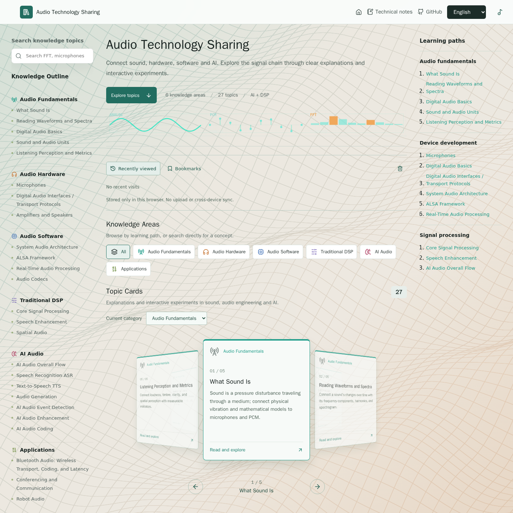
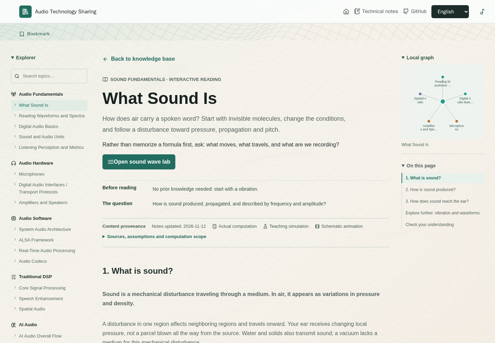

<p align="center">
  <h1 align="center">音频技术分享</h1>
  <p align="center">
    动手调参数，看波形如何变化，再结合多语言工程文章理解声音背后的原理。
  </p>
</p>

<p align="center">
  <a href="../README.md">English</a> ·
  <a href="./README.zh-CN.md">简体中文</a> ·
  <a href="./README.zh-TW.md">繁體中文</a> ·
  <a href="./README.ja.md">日本語</a> ·
  <a href="./README.ko.md">한국어</a>
</p>

<p align="center">
  
  
  
  
  
</p>

---

## 项目简介
音频技术分享 是一个内容优先的资料仓库和网页应用，用于把音频技术相关知识整理成可搜索的卡片、图解文章和交互式实验室。

当前网页可用于浏览音频基础、硬件、软件、信号处理、AI 音频算法和真实应用场景。主题卡片可以打开详细解释和对应实验室，方便用图解或交互方式理解关键概念。

**[在线访问网站](https://cpw640530.github.io/audio-technology-sharing/)** · 支持简体中文、繁体中文、英文、日语和韩语。

## 交互式实验室：让原理变成看得见的变化

位深增加，量化误差为什么会变小？窗口变长，频谱图为什么不同？回声消除到底减掉了什么？通过参数调节与对照实验理解这些问题，而不只是记住定义。

| 实验室 | 可以动手做什么 | 重点看懂什么 |
| --- | --- | --- |
| 声音波形 | 调节频率、振幅、相位，并播放信号 | 将正弦模型、波形变化和听感联系起来 |
| 波形与频谱 | 调节三个谐波分量及相对相位 | 对照逐点叠加与理想幅度线谱，试听同一组系数，不自动归一化 |
| 采样、量化与 PCM | 比较疏密采样、2-bit/8-bit 量化，查看样本码字 | 区分时间采样与幅度精度，追踪量化值如何变成二进制 |
| FFT / STFT | 对比单音与相邻双音、长短窗口、Hop 大小和短脉冲 | 跟随选中 PCM 窗口观察频谱，区分频率格间距与分开相邻频率的能力 |
| AEC 回声消除 | 用 0%、50%、100% 模型强度对比四轨信号 | 串起播放参考、采集输入、估计回声与输出，理解为什么不能直接用采集减播放 |

**体验路径：**[进入知识库](https://cpw640530.github.io/audio-technology-sharing/#top) → 打开主题详细内容 → 进入对应实验室。遇到不懂的概念，可随时返回文章。硬件、ALSA、空间音频及应用场景也提供图解或交互探索。

<p align="center">
  
</p>

**用于学习，不替代测量仪器。** 实验室区分概念示意、数值仿真和音频演示，并非每个实验都有试听。AEC 使用已知合成分量，不是生产级自适应消除器；满强度残余只是模型设定，不代表真实设备性能上限。进行听感对比前，请暂停背景音乐。

截图展示的是较早界面；近期新增的对照预设需部署后才会出现在在线网站。

## 界面与阅读路径

- **找到主题**：通过左侧知识分类大纲定位，或在主内容区搜索、筛选主题卡片；小屏幕采用单列布局。
- **阅读详细内容**：进入主题文章，结合本页目录、流程图和工程说明理解知识点，并通过相邻主题入口继续阅读。
- **进入实验室**：从文章进入对应实验室，通过交互参数或分步图解验证概念；可返回详细内容或知识库。
- **继续拓展**：独立的技术笔记栏目用于工作相关学习记录；首页底部提供参考与延伸阅读网站。
- **切换语言**：首次访问默认英文，网站会记住语言选择。缓慢起伏的三维波形曲面仅作为背景，不拦截操作；减少动态效果时静止显示，无法使用 WebGL 时保留页面底色。

以下截图采集于 2026 年 10 月 28 日的生产构建，截取时暂停背景动画以便阅读。本地修改需部署后才会出现在在线网站。

<p align="center">
  
</p>

## 详细文章

主题文章串联基本概念、工程边界与实践验证。左侧本页目录用于定位章节，实验室入口将阅读自然衔接到交互验证。

<p align="center">
  
</p>

## 为什么建立这个仓库

音频技术横跨物理声学、电子硬件、嵌入式系统、操作系统、数字信号处理、机器学习和产品应用。这个仓库把这些主题放在一个结构化位置，方便后续稳定扩展网页内容。

它适合用于：

- 准备音频技术分享网站内容。
- 构建文章大纲和专题页面。
- 规划音频信号链路和算法图解。
- 将传统 DSP 与 AI 音频概念放在同一套知识体系中。
- 为后续音频技术项目建立可复用的内容基础。

## 知识范围

<p align="center">
  
</p>

| 方向 | 主题 |
| --- | --- |
| 音频基础 | 声音、音频单位、采样、量化、编码、听感与指标、读懂波形与频谱 |
| 音频硬件 | 麦克风、数字音频接口、功放与扬声器 |
| 音频软件 | 系统音频架构、ALSA、实时音频处理、音频编解码 |
| 传统算法 | 基础信号处理（FFT/STFT、滤波、EQ、动态处理）、语音增强、空间音频 |
| AI 音频 | 总处理流程、ASR、TTS、音频生成、事件识别、音频增强、神经音频编码 |
| 应用场景 | 蓝牙音频、会议通信、机器人、车载声学、IoT 与内容创作 |

## 快速开始

在线访问网页：

- [https://cpw640530.github.io/audio-technology-sharing/](https://cpw640530.github.io/audio-technology-sharing/)

先从主知识大纲开始阅读：

- [音频技术分享知识大纲](../docs/audio_technology_knowledge_outline.md)

大纲提供内容概览。当前主题元数据位于 `src/content/knowledge.ts`，详细文章与实验室在 `src/components/` 中实现。

本地运行网页应用：

```bash
npm install
npm run dev
```

常用命令：

```bash
npm test
npm run build
```

## 内容结构

```text
.
├── README.md
├── READMEs/
│   ├── README.zh-CN.md
│   ├── README.ja.md
│   └── README.ko.md
├── index.html
├── package.json
├── src/
│   ├── App.tsx
│   ├── components/
│   ├── content/
│   └── styles.css
└── docs/
    └── audio_technology_knowledge_outline.md
```

## 学习示例

文章与实验室将基础概念连接到具体问题：

- **入门指南**：采样率、位深、频响曲线、音频格式、蓝牙延迟。
- **硬件原理**：麦克风、ADC/DAC 转换、数字接口、功放与扬声器。
- **算法图解**：FFT、滤波、降噪、回声消除、波束成形。
- **AI 音频系列**：语音识别、语音合成、AI 降噪、声音克隆、音频生成。
- **应用案例**：会议音频系统、智能音箱、车载语音交互、直播音频处理。

## 语言

README、网页界面、详细文章和实验室支持简体中文、繁体中文、英文、日语和韩语。使用网页的语言选择框即可原地切换，网站会记住选择。标准模型名称、代码、公式及参考图片内的原始文字保持不变。

网页另提供“繁體中文”（`zh-Hant`），使用 ICU 将简体正文转换为通用繁体字形，尚未单独本地化地区术语。转换表随网站打包，不调用在线翻译服务。维护者更新中文正文后，可在安装 ICU `uconv` 的环境运行 `node scripts/generate-traditional.cjs` 更新词组映射。

- [English](../README.md)
- [简体中文](./README.zh-CN.md)
- [繁體中文](./README.zh-TW.md)
- [日本語](./README.ja.md)
- [한국어](./README.ko.md)

GitHub README 不支持运行 JavaScript，因此语言切换使用普通 Markdown 链接实现。

## License

暂未选择开源许可证。
