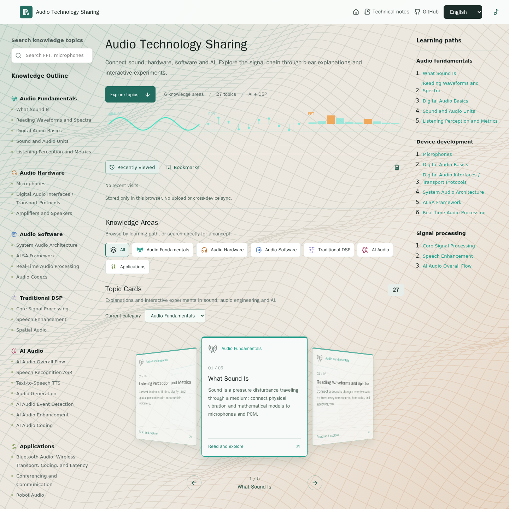
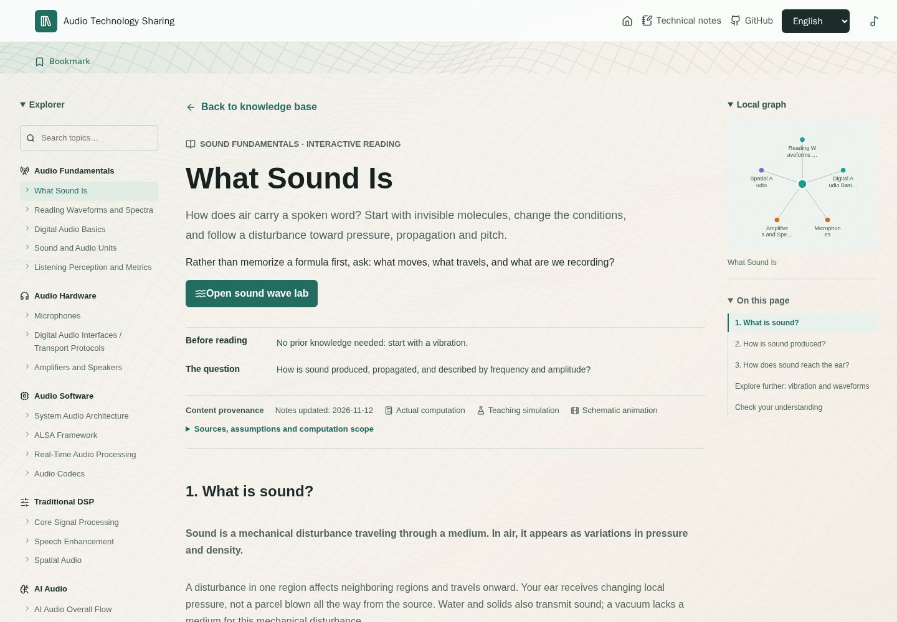
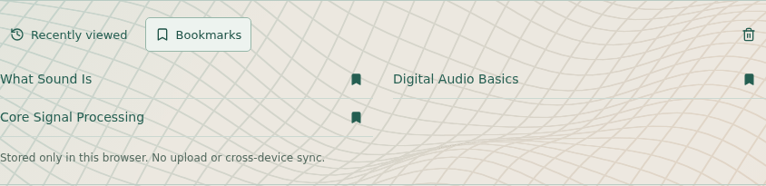

<h1 align="center">音頻技術分享</h1>
<p align="center">順著信號學原理，動手調參數，看懂結果為甚麼變化。</p>

<p align="center">
  <a href="../README.md">English</a> ·
  <a href="./README.zh-CN.md">简体中文</a> ·
  <a href="./README.zh-TW.md">繁體中文</a> ·
  <a href="./README.ja.md">日本語</a> ·
  <a href="./README.ko.md">한국어</a>
</p>

<p align="center">
  
  
  
</p>

## 在線體驗

**[訪問網站](https://cpw640530.github.io/audio-technology-sharing/)** · **[瀏覽知識庫](https://cpw640530.github.io/audio-technology-sharing/#top)** · **[直接體驗聲音波形實驗室](https://cpw640530.github.io/audio-technology-sharing/#/labs/sound-wave)**

音頻技術分享是面向學生、工程師和音頻愛好者的可視化知識庫。它通過圖解文章與交互實驗，把聲音、硬件、軟件、DSP、AI 和應用場景串成學習路徑，而不只是羅列術語。

目前包含 **6 個知識分類、27 篇主題文章、22 個獨立實驗室**，支持簡體中文、繁體中文、英文、日語和韓語。部分主題通過文章內的圖解與演示講解，不另設實驗室。

<p align="center"></p>

本頁截圖統一採集自 **2026 年 11 月 12 日的生產構建**，使用英文界面與減少動態效果設置；網頁可切換上述五種語言。截圖反映本地構建，不代表已核驗線上最新部署。

## 交互式實驗室：讓原理變成看得見的變化

位深增加，量化誤差為甚麼會變小？窗口變長，頻譜圖為甚麼不同？回聲消除到底減掉了甚麼？通過調整條件、對照結果理解這些問題，而不只是記住定義。

| 實驗室 | 可以動手做甚麼 | 重點看懂甚麼 |
| --- | --- | --- |
| [聲音波形](https://cpw640530.github.io/audio-technology-sharing/#/labs/sound-wave) | 調節頻率、振幅、相位，並播放信號 | 區分週期、幅度和相位的作用 |
| [波形與頻譜](https://cpw640530.github.io/audio-technology-sharing/#/labs/wave-spectrum) | 調節諧波分量和相對相位 | 將時域疊加與理想幅度線譜聯繫起來 |
| [數字音頻](https://cpw640530.github.io/audio-technology-sharing/#/labs/sampling-quantization) | 對比採樣與量化，查看 PCM 碼字和 DAC 重建 | 分清時間採樣、幅度精度與重建過程 |
| [FFT / STFT](https://cpw640530.github.io/audio-technology-sharing/#/labs/core-signal-processing) | 比較相鄰雙音、窗口長度、Hop 大小和短脈衝 | 跟隨 PCM 窗口觀察頻譜，區分頻率格間距與分辨相鄰頻率的能力 |
| [語音增強](https://cpw640530.github.io/audio-technology-sharing/#/labs/speech-enhancement) | 切換 AEC、降噪和 AGC，改變處理強度 | 對照各階段輸入輸出，追蹤前級處理對後級的影響 |

<p align="center"></p>

**用於學習，不替代測量儀器。** 文章與實驗室區分真實計算、教學模擬和示意動畫，並注明參考來源、維護日期與模型假設。AI 演示**不運行所引用的生產模型，也不復現其基準成績**。AEC 使用已知合成分量，不是生產級自適應消除器。並非每個實驗都有試聽；進行聽感對比前，請暫停背景音樂。

## 從閱讀到實驗，再到下一篇

1. **找到主題**：通過左側知識分類大綱、搜索、分類篩選及旋轉卡片瀏覽內容，小屏幕自動調整佈局。
2. **帶著問題閱讀**：文章說明「先瞭解甚麼、本篇解決甚麼、下一步看甚麼」，配合章節目錄和可拖動的局部關係圖串起知識。
3. **動手驗證**：有實驗室的主題可以進入交互驗證，再返回文章。詳細內容負責原理，實驗室重點呈現控制條件、觀察現象和結果解釋。
4. **直接分享文章**：文章與實驗室都有獨立的 hash 地址，例如 [甚麼是聲音](https://cpw640530.github.io/audio-technology-sharing/#/topics/sound-wave)。可以直接打開或刷新，不需要為每篇文章配置服務器目錄。

<p align="center"></p>

緩慢起伏的三維波形曲面僅作背景，不攔截操作；減少動態效果時靜止顯示，WebGL 不可用時在支持的環境中回退到 Canvas 2D 投影曲面。技術筆記作為獨立欄目保留，知識庫底部還提供參考與延伸閱讀網站。

## 再次訪問，接著學

- **最近閱讀**：保留最近訪問的最多 8 個主題，也能回到上次進入的實驗室。
- **收藏主題**：在文章或實驗室收藏、取消收藏，從首頁快速找回。
- **恢復實驗參數**：已接入的控制項會在校驗後恢復，也可以一鍵恢復當前實驗默認參數。不恢復播放、上傳音頻或臨時動畫狀態。
- **只保存在此瀏覽器**：不做賬號，不上傳，不跨設備同步。確認清除本地學習數據後，會刪除閱讀記錄、收藏和實驗參數，但保留語言選擇。清理瀏覽器或站點數據也會刪除這些記錄；存儲不可用時界面會提示。

<p align="center"></p>

## 知識範圍

| 方向 | 主題 |
| --- | --- |
| 音頻基礎 | 聲音、波形與頻譜、採樣、量化、編碼、音頻單位、聽感與指標 |
| 音頻硬件 | 麥克風、數字音頻接口、功放與揚聲器 |
| 音頻軟件 | 系統音頻架構、ALSA、實時音頻處理、音頻編解碼 |
| 傳統算法 | FFT/STFT、濾波、EQ、動態處理、語音增強、空間音頻 |
| AI 音頻 | 總處理流程、ASR、TTS、音頻生成、事件識別、音頻增強、神經音頻編碼 |
| 應用場景 | 藍牙音頻、會議通信、機器人、車載聲學、IoT 與內容創作 |

<p align="center"></p>

## 本地運行

安裝 Node.js 和 npm 後，使用倉庫鎖文件安裝依賴：

```bash
npm ci
npm run dev
```

運行驗證與生產構建：

```bash
npm test
npm run build
```

文章與實驗室代碼按需加載，歡迎頁使用響應式 WebP 圖片並保留 PNG 回退。具體測量與剩餘限制見[加載性能記錄](../docs/loading-performance-2026-11-12.md)，不代表所有設備都能達到相同流暢度。

## 內容與維護

| 位置 | 職責 |
| --- | --- |
| `README.md`、`READMEs/` | 五種語言的項目介紹，包含 `README.zh-TW.md` |
| `src/content/knowledge.ts` | 分類、主題元數據與實驗室入口 |
| `src/content/topicRoutes.ts` | 文章、實驗室地址與路由映射 |
| `src/content/topicLearning.ts` | 先修關係、學習問題與下一篇推薦 |
| `src/content/topicCredibility.ts` | 來源、更新時間、演示性質與模型邊界 |
| `src/components/` | 詳細文章、圖解、實驗室與共享閱讀界面 |
| `src/hooks/useLabState.tsx` | 帶校驗的實驗參數本地保存 |
| `src/styles.css` | 共享樣式與響應式佈局 |
| `public/images/` | 插圖及本頁使用的截圖 |

[音頻技術分享知識大綱](../docs/audio_technology_knowledge_outline.md)提供內容概覽；[本地回訪說明](../docs/local-return-visits.md)記錄存儲、重置和隱私邊界。當前實現以主題源碼為準。

## 語言

README、網頁界面、詳細文章和實驗室支持**簡體中文、繁體中文、英文、日語和韓語**。網頁首次訪問默認英文，並記住所選語言。標準模型名稱、代碼、公式及參考圖片內的原始文字保持不變。GitHub 通過普通鏈接切換各語言 README，無需 JavaScript。

繁體中文（`zh-Hant`）使用本地打包的 ICU 字形轉換映射，由簡體正文生成，不調用在線翻譯服務，尚未單獨本地化地區術語。維護者更新中文正文後，可在安裝 ICU `uconv` 的環境運行 `node scripts/generate-traditional.cjs` 更新映射。

## License

暫未選擇開源許可證。
